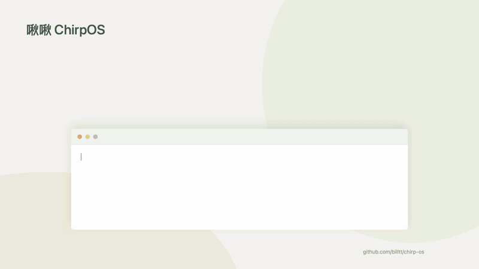

# 啾啾 ChirpOS

**下载 / Download**

| 平台 / Platform | 最新版本 / Latest release |
| --- | --- |
| Windows · Intel / AMD 64-bit | [下载 ZIP · v0.5.0](https://github.com/billtt/chirp-os/releases/download/v0.5.0/ChirpOS-0.5.0-win-x64.zip) |
| Windows · ARM64 / UTM | [下载 ZIP · v0.5.0](https://github.com/billtt/chirp-os/releases/download/v0.5.0/ChirpOS-0.5.0-win-arm64.zip) |
| macOS · Apple Silicon | [下载 ZIP · v0.5.0](https://github.com/billtt/chirp-os/releases/download/v0.5.0/ChirpOS-0.5.0-macOS-arm64.zip) |

[所有版本 / All releases](https://github.com/billtt/chirp-os/releases) · [简体中文](#中文) · [English](#english)

**让你的桌面，时不时来只鸟。 / A little birdlife on your desktop.**

## 中文

啾啾是一款 macOS 和 Windows 桌面观鸟应用。像素小鸟从屏幕外飞来，在窗口顶沿歇脚、眨眼、理羽，陪你工作。它们不抢焦点，也不会挡住鼠标操作。

### 有什么好玩的

- 多种小鸟，各有鲜明外形和习性动作，详见下方[鸟种列表](#鸟种--bird-species)。
- 飞行节奏按鸟种定制：猛禽交替振翅、滑翔与长时间盘旋；鹭类缓慢深拍，小型林鸟短促振翅，燕类转弯，啄木鸟起伏飞行。
- 小鸟随窗口缓慢移动，快速拖动时可能受惊飞走；前方窗口会遮住后方停留的小鸟。
- 没有合适的窗口落点时，小鸟会在 Dock／任务栏上方的屏幕底部歇脚；支持多屏及自动隐藏。
- 鸟群随机飞入、飞出，可设置数量范围，例如 3–5、8–12 或 15–20 只。
- 自由调整每种鸟的出现概率并锁定；也可设置体长、振翅频率、飞速和停留时间。
- 鼠标停在小鸟身上约 1 秒，头顶就会显示名字；点击仍会穿透。
- 夜鹭会长时间守望、伸颈、抖毛，偶尔“挤洗手液”；大斑啄木鸟会沿窗口侧边停靠、啄击。
- 菜单中的“图鉴”以网格展示全部鸟种，顶部手动选择休息、飞行、振翅、滑翔、着陆、理羽或其他习性动作。
- 每小时自动检查更新，下载并校验后以气泡提醒；确认后安装并重启。忽略或稍后处理时保留红点和菜单入口。
- 支持中英文切换、暂停动画和随系统启动。

### 鸟种 / Bird species

| 中文 | English |
| --- | --- |
| 红耳鹎 | Red-whiskered Bulbul |
| 麻雀 | Eurasian Tree Sparrow |
| 白头鹎 | Light-vented Bulbul |
| 珠颈斑鸠 | Spotted Dove |
| 乌鸫 | Chinese Blackbird |
| 鹊鸲 | Oriental Magpie-Robin |
| 棕背伯劳 | Long-tailed Shrike |
| 夜鹭 | Black-crowned Night Heron |
| 红尾水鸲 | Plumbeous Water Redstart |
| 白鹭 | Little Egret |
| 苍鹭 | Grey Heron |
| 红隼 | Common Kestrel |
| 游隼 | Peregrine Falcon |
| 黑鸢 | Black Kite |
| 普通鵟 | Common Buzzard |
| 喜鹊 | Oriental Magpie |
| 灰喜鹊 | Azure-winged Magpie |
| 大嘴乌鸦 | Large-billed Crow |
| 戴胜 | Eurasian Hoopoe |
| 家燕 | Barn Swallow |
| 绿头鸭 | Mallard |
| 噪鹃 | Asian Koel |
| 暗绿绣眼鸟 | Swinhoe’s White-eye |
| 红嘴鸥 | Black-headed Gull |
| 中杓鹬 | Whimbrel |
| 斑鱼狗 | Pied Kingfisher |
| 丘鹬 | Eurasian Woodcock |
| 黑卷尾 | Black Drongo |
| 池鹭 | Chinese Pond Heron |
| 白眉姬鹟 | Yellow-rumped Flycatcher |
| 黄眉柳莺 | Yellow-browed Warbler |
| 大山雀 | Great Tit |
| 黑水鸡 | Common Moorhen |
| 大斑啄木鸟 | Great Spotted Woodpecker |
| 棕头鸦雀 | Vinous-throated Parrotbill |
| 黑翅长脚鹬 | Black-winged Stilt |
| 白骨顶 | Eurasian Coot |
| 红嘴相思鸟 | Red-billed Leiothrix |
| 黑领椋鸟 | Black-collared Starling |
| 普通翠鸟 | Common Kingfisher |
| 金眶鸻 | Little Ringed Plover |
| 黑尾蜡嘴雀 | Yellow-billed Grosbeak |
| 红胁蓝尾鸲 | Red-flanked Bluetail |
| 领角鸮 | Collared Scops Owl |
| 斑头鸺鹠 | Asian Barred Owlet |
| 纵纹腹小鸮 | Little Owl |

### 开始观鸟

**Windows：** 下载对应架构的 ZIP，解压后运行 ChirpOS.exe，无需安装 .NET。支持 Windows 10/11 x64 和 Windows 11 ARM64。

**macOS：** 下载并解压 ZIP，将 `ChirpOS.app` 拖入“应用程序”后打开。下载版适用于 macOS 13 及以上的 Apple Silicon Mac。

启动后稍等片刻，小鸟就会陆续飞入。点击 macOS 菜单栏或右键点击 Windows 系统托盘中的小鸟图标，即可调整设置或退出。Windows 图标可能位于托盘的隐藏图标区域。更新前请先退出正在运行的版本。

启动时发现新增鸟种，会询问是恢复所有默认概率、按新旧鸟种数量比例分配，还是保留原概率并手动设置。手动模式会直接定位到第一种新鸟；按数量分配会缩放锁定项，但保留锁定状态。体型按成年鸟代表体长进行非线性缩放（红耳鹎 1×、苍鹭 2.5×），部分配色采用雄鸟或繁殖羽；动作经过像素化简化。

macOS 版本使用 Developer ID 签名并经过 Apple 公证。Windows 版本尚未使用发布者证书签名，首次打开可能遇到系统安全提示。

### 隐私与反馈

啾啾在本机运行，仅读取窗口位置、前后顺序和用于悬停识别的鼠标位置，不读取窗口标题或内容，也不上传窗口信息或个人设置。自动更新会连接 GitHub 检查版本并下载官方安装包。窗口遮挡按矩形估算，透明窗口、圆角和特殊系统界面的效果可能有所不同。

遇到问题或有新点子，欢迎提交 [Issue](https://github.com/billtt/chirp-os/issues)。想自己构建或贡献代码，请看[开发指南](docs/DEVELOPMENT.md)。

## English

ChirpOS brings pixel-art birds to your macOS or Windows desktop. They fly in from offscreen, perch on window edges, blink, and preen while you work—without taking focus or intercepting mouse clicks.

### Features

- Distinctive bird species, each with its own appearance and behavior. See the [Chinese–English species list](#鸟种--bird-species).
- Species have individual flight rhythms: raptors alternate powered flight with extended soaring, herons use slow strokes, small woodland birds use short bursts, swallows weave and woodpeckers bound.
- Birds follow gently moved windows and may startle when dragged quickly. Foreground windows hide birds perched behind them.
- When window perches are unavailable, birds rest along the screen bottom above the Dock or taskbar, including multi-monitor and auto-hide layouts.
- Birds arrive and leave at random, with configurable population ranges such as 3–5, 8–12, or 15–20.
- Adjust and lock arrival probabilities, and customize size, wingbeat rate, speed, and perch duration.
- Hover over a bird for about 1 second to see its name, with clicks still passing through.
- Night herons watch, stretch, shake and occasionally leave a fleeting dropping; woodpeckers cling to and peck window sides.
- Open “Field guide” for a grid of all species; choose Rest, Flight, Flapping, Gliding, Landing, Preening or Other from the fixed action bar.
- Hourly update checks download and verify new releases in the background. A notification opens release notes and installation confirmation; a red dot and menu entry remain if you postpone.
- Chinese and English menus, animation pause, and launch at login.

### Get started

**Windows:** Download the ZIP for your architecture, extract it, and run ChirpOS.exe. No separate .NET installation is needed. Supports Windows 10/11 x64 and Windows 11 ARM64.

**macOS:** Extract the ZIP, move `ChirpOS.app` to Applications, and open it. The download supports Apple Silicon Macs running macOS 13 or later.

Birds begin arriving shortly after launch. Use the macOS menu bar icon or right-click the Windows tray icon for settings and quit. The Windows icon may be in the hidden-icons area. Quit the running version before updating.

When new species are detected at startup, choose default probabilities, allocation by species count, or manual configuration. Manual mode jumps to the first new species. Count-based allocation scales locked values but retains their lock state. Sizes use compressed adult-length ratios (bulbul 1×, Grey Heron 2.5×); some designs show males or breeding plumage, with stylized pixel animation.

The macOS app is Developer ID-signed and notarized by Apple. Windows builds are not publisher-signed, so a system security prompt may appear on first launch.

### Privacy & feedback

ChirpOS runs locally. It reads window geometry, stacking order and pointer position for hover identification, not window titles or content, and never uploads window information or personal settings. Automatic updates contact GitHub to check releases and download official packages. Occlusion uses rectangular bounds; transparent windows, rounded corners, and special system views may look different.

Report a bug or suggest an idea in [Issues](https://github.com/billtt/chirp-os/issues). For building and contributing, see the [development guide](docs/DEVELOPMENT.md).

---

[MIT License](LICENSE)
